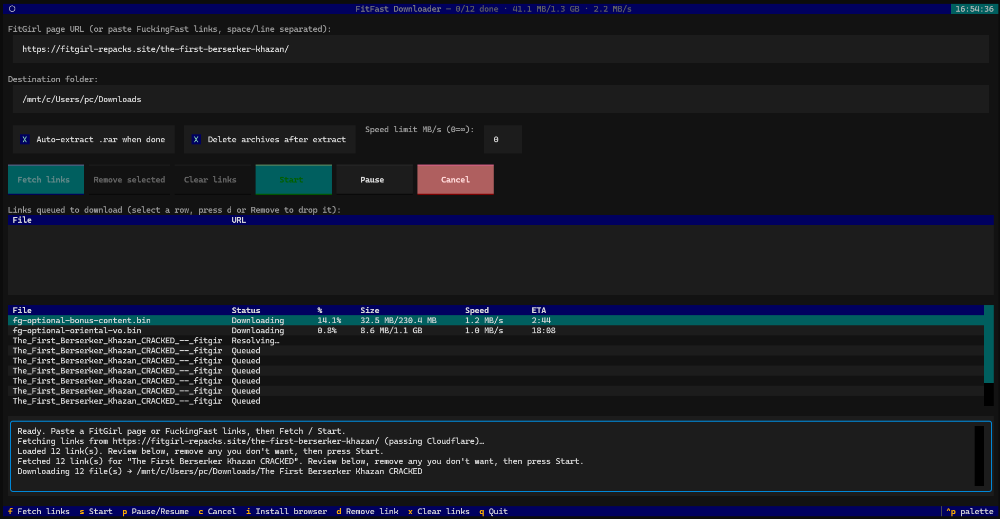

# FitFast Downloader — terminal edition

**Download FitGirl Repacks from fuckingfast.co, from your terminal.** Paste a game page, press Fetch, press Start. It collects every part, gets past Cloudflare, downloads the whole set, and unpacks it for you — with live per-file progress, resume, and a speed limit.




> **This is a fork.** The original [FitFast Downloader](https://github.com/DEM9N101/FitFast-Downloader) by DEM9N101 is a Windows-only Tkinter app shipped as an `.exe` installer. This fork replaces it with a **terminal UI** and a long list of correctness fixes found by driving real 100+ part repacks to completion. See [What this fork adds](#what-this-fork-adds).

---

## What is this?

FitGirl repacks come as a big stack of `.rar` files (`part001`, `part002`, …) hosted on **fuckingfast.co**. That host puts a Cloudflare wall in front of every link, which is why plain download managers like JDownloader get blocked, and it makes you click each part by hand.

FitFast does the whole thing:

1. Scrapes the FitGirl game page for every FuckingFast part link.
2. Opens each link in a **stealth browser** (Camoufox) that clears Cloudflare on its own and reads out the real signed download URL.
3. Hands that URL to **aria2**, downloading several files at once with live progress, pause/resume and an optional speed cap.
4. Unpacks the finished `.rar` set with **unar**/**unrar** into your game folder.

Interrupt it whenever you like. It records what finished on disk, so restarting picks up exactly where it left off — no re-resolving, no re-downloading.

---

## Install

You need **Python 3.11+**, **aria2c**, and **unar** (or `unrar`) on `PATH`.

### With devenv / Nix (everything provisioned for you)

```sh
devenv shell        # python + aria2 + unar + the libs
camoufox sync       # refresh the available-version list FIRST (see below)
camoufox fetch      # ONE TIME: downloads the stealth browser (~1GB)
python fitfast_tui.py
```

Or just `make tui`, which does the same in one step.

> **On NixOS specifically** you must enable `programs.nix-ld.enable = true;` in `configuration.nix` once and rebuild — Camoufox's Firefox and Playwright's driver are prebuilt dynamically-linked binaries and won't start without it. Full explanation in [NIXOS.md](NIXOS.md).

### On any other Linux / macOS

```sh
python -m venv .venv && . .venv/bin/activate
pip install -r requirements.txt
sudo apt install aria2 unar        # or your package manager's equivalent
camoufox sync                      # refresh the version list first
camoufox fetch                     # one-time stealth browser download
python fitfast_tui.py
```

The browser download only happens once. If you skip it, the app tells you and you can press **i** inside the TUI to install it.

---

## Using it

**1. Get the links.** Paste a `fitgirl-repacks.site` game URL into the top box and press **f** (or click **Fetch links**). It loads the page past Cloudflare and collects every part.

*Already have direct `fuckingfast.co` links? Paste them into the same box instead, space- or newline-separated.*

**2. Review the queue.** Fetched links land in the **Links queued** table *before* anything downloads. Select a row and press **d** to drop it, or **x** to clear the lot — handy for skipping optional bonus content, language packs, and soundtracks.

**3. Set the destination** in the second box. A subfolder named after the game is created inside it automatically.

**4. Start.** Press **s**. The lower table shows per-file status, percentage, size, speed and ETA; the header shows the batch total and combined throughput. When everything lands, the `.rar` set is extracted automatically.

### Keys

| Key | Action |
| --- | --- |
| **f** | Fetch links from the pasted page |
| **s** | Start downloading |
| **p** | Pause / resume |
| **c** | Cancel (stops aria2 and the browser cleanly) |
| **d** | Remove the selected queued link |
| **x** | Clear all queued links |
| **i** | Install the stealth browser (one-time) |
| **q** | Quit |
| **^p** | Command palette |

Single-letter keys fire when focus isn't inside a text box — otherwise Tab to a button and press Enter.

### Options

| Control | What it does |
| --- | --- |
| **Auto-extract .rar when done** | Unpacks the archive set once every part has downloaded. |
| **Delete archives after extract** | Removes the `.rar` files after a *successful* extraction, to reclaim space. |
| **Speed limit MB/s (0=∞)** | Caps total download speed across all files. Type a new value and press Enter to apply it **live**, mid-download. |

### Web UI (share it with someone)

`python fitfast_web.py` (or `make web`) serves a password-protected page that turns a FitGirl page into direct, Cloudflare-free download links for someone else to paste into JDownloader or any download manager. It resolves links and downloads nothing. See [WEB.md](WEB.md).

---

## What this fork adds

Everything below is new relative to upstream `DEM9N101/FitFast-Downloader`. Most of it came out of running real multi-hundred-gigabyte repacks and fixing what actually broke.

### The terminal UI, and getting off Windows

- **`app/tui.py` — a full Textual TUI** replacing the upstream Windows Tkinter GUI, which has been removed along with its PyInstaller/Inno Setup packaging and vendored `.exe` binaries. Live per-file progress table, pause/cancel, auto-extract, batch totals in the header.
- **System tools only.** `aria2c` comes from `PATH`; the extractor finds `unrar`, `rar`, or **`unar`** — the free RAR5 / multi-volume extractor, which is what makes NixOS viable.
- **`devenv.nix` + `NIXOS.md`** — a reproducible dev shell with Python, aria2 and unar, plus the `NIX_LD_LIBRARY_PATH` / `LD_LIBRARY_PATH` wiring that lets Camoufox's prebuilt Firefox and Playwright's node driver actually launch on NixOS.
- **`Makefile`** — `make tui` to launch the terminal UI inside the dev shell.

### Review the queue before committing to it

- **Pending-links table** with Remove / Clear (`d` / `x`). Upstream committed you to the entire fetched batch blind; a 12-part repack usually includes bonus content you don't want.

### Resume that is instant and *correct*

- **On-disk state cache (`app/state.py`).** A `.fitfast.json` manifest per destination folder, keyed by source URL, recording filename, expected size, and whether the file was ever actually seen to finish. Resuming a 40-part repack with 39 done used to cost ~20 minutes of headless Firefox re-resolving every link just to discover there was nothing to do. Now it starts neither Camoufox nor aria2c.
- **It also fixes silent corruption.** With `--file-allocation=falloc`, an interrupted part is *byte-size identical* to a finished one; lose the `.aria2` control file and aria2 reports "complete" without transferring anything, leaving a truncated archive that dies at extraction. Completeness is now trusted only when the manifest, the exact size, and the absence of a control file all agree.
- **Resume in place** instead of creating `Game (2)`, `Game (3)` folders on every restart.
- Files with **no manifest entry are never touched** — a download from another tool or an older version is always safe.

### Downloads that don't wedge

- **The big one: one connection per file.** FuckingFast's signed CDN ignores the *end* of a bounded HTTP Range request and always answers to EOF, so aria2's 16-connection segmented mode rejected every response with `Invalid range header` and the part failed — forever. Parallelism now comes from downloading several *files* at once. Confirmed against the live CDN.
- **Healing fragmented partials.** Files left holey by the old multi-connection code could never be completed (the CDN can't fill an interior hole). They're now truncated back to their known-good contiguous prefix so aria2 resumes sequentially.
- **`--file-allocation=none`.** `fallocate()` returns "Operation not supported" on WSL's `/mnt/c` drvfs mounts, so every part failed instantly at allocation. Preallocation only ever helped multi-connection random writes, which we no longer do.
- **Retries that give up, and say why.** A part that keeps *advancing* between failures retries indefinitely with backoff. A part that fails 8 times without moving a single byte enters a terminal `failed` state instead of churning the single browser resolver forever. Every per-part failure is logged with its real reason — upstream logged batch totals only, making failures undiagnosable.
- **Hang-proof resolution.** Camoufox/Playwright browser launch has no timeout and can wedge a thread permanently — observed twice, each time silently killing a download while the process still looked busy. Resolution now runs in a **throwaway subprocess** with a hard timeout that kills the whole process tree on expiry; the OS guarantees termination where the library can't.
- **Cancel actually stops things.** `Cancel` used to pause downloads without closing aria2c or Camoufox, so every cancel→start cycle orphaned another aria2c *and* another browser in the background.
- **Vanished-file detection.** Antivirus quarantining a completed archive used to look like success. It's now detected and reported by name.

### Correctness fixes over upstream

- **Filenames come from the URL fragment, not the page title.** FuckingFast serves an identical `<title>` for every part of a repack, so all parts resolved to one colliding filename.
- **Reliable link fetching.** Headless Camoufox intermittently crashes seconds after these ad-heavy pages load; links are now grabbed immediately after `domcontentloaded`, with spoiler-expansion as best-effort afterwards and a retry if the browser dies before the first grab.
- **Dropped the pre-flight `HEAD` check** upstream of aria2 — the signed URL is effectively single-use, and touching it first burned the token.
- **Speed limit** (`--max-overall-download-limit`), adjustable live mid-download via aria2's RPC.

---

## Troubleshooting

**Fetch fails with a browser or driver launch error.**
On NixOS this is almost always missing `nix-ld` — see [NIXOS.md](NIXOS.md). Elsewhere, check that `camoufox fetch` completed.

**"Couldn't fetch links from that page."**
Make sure it's a FitGirl **game page**, not the homepage or an "upcoming repacks" post.

**A part crawls at a few KB/s.**
That's the host handing you a slow server. It'll be retried and re-resolved automatically; you can also try again when the host is less busy.

**Some parts ended in `failed`.**
They failed 8 times without transferring a byte. The reason for each is in the log pane and the log file. Signed URLs also expire — pressing **s** again re-resolves and continues from the partials on disk.

**It downloaded but didn't extract.**
Check that **Auto-extract** is ticked and that `unar` or `unrar` is on `PATH`. The TUI warns at startup if it can't find either.

---

## Disclaimer

FitFast Downloader is an independent, unofficial tool. It is **not affiliated with, endorsed by, or connected to FitGirl, FitGirl Repacks, fuckingfast.co, or any file host** in any way. Those names are used only to describe what the tool is compatible with.

This program does not host, provide, or distribute any files or content. It is a general download client for the fuckingfast.co file host, and it only downloads links that you choose to give it. What you download, and whether you have the right to do so, is entirely your responsibility. Please respect the laws where you live and the terms of the websites you use.

The software is provided as is, without warranty of any kind. Use it at your own discretion and your own risk. The authors are not responsible for how you use it or for any data loss, legal issue, or damage that results.

## License

MIT, as upstream. External tools keep their own licenses: [aria2](https://github.com/aria2/aria2) (GPLv2) and [unar](https://theunarchiver.com/command-line) (LGPL).

Original work © DEM9N101 — [DEM9N101/FitFast-Downloader](https://github.com/DEM9N101/FitFast-Downloader).
